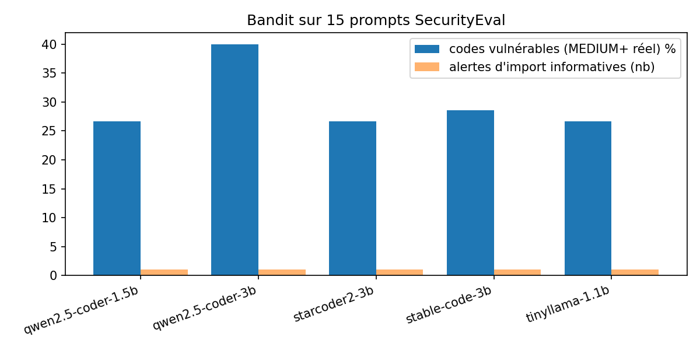
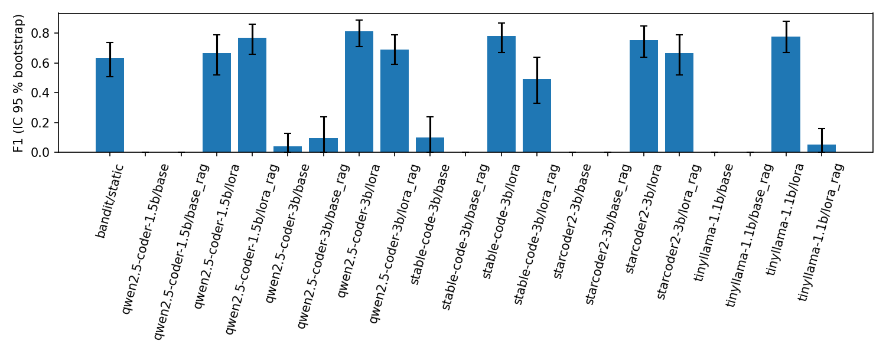
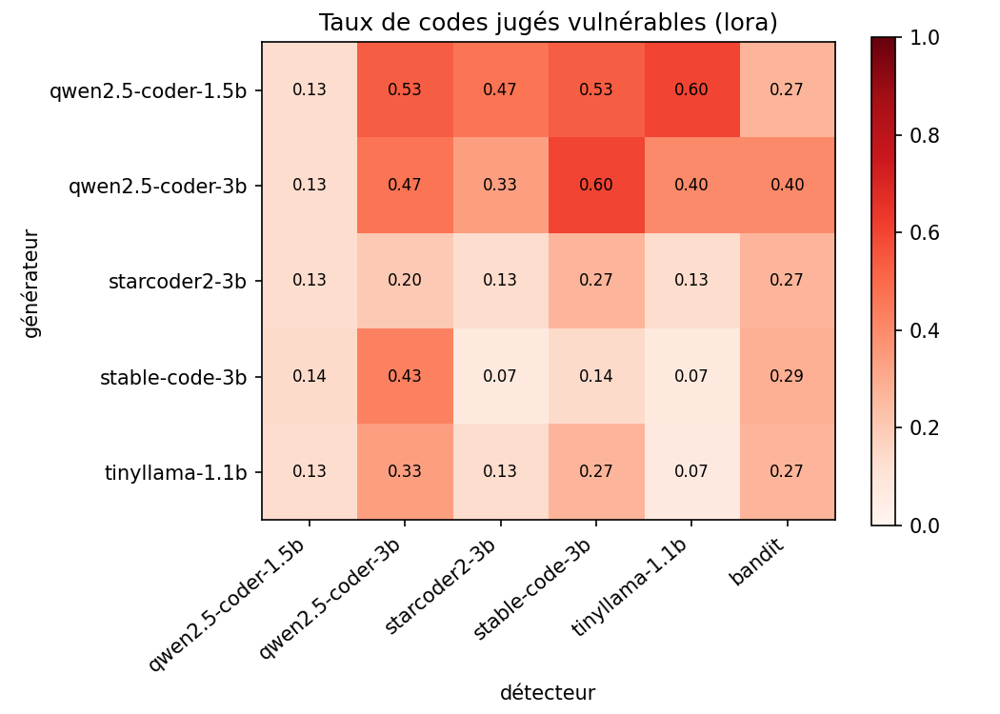
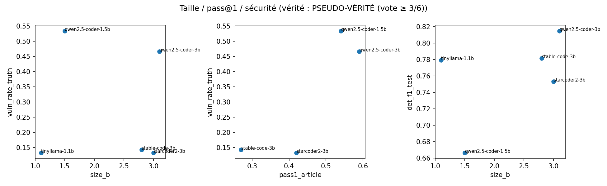
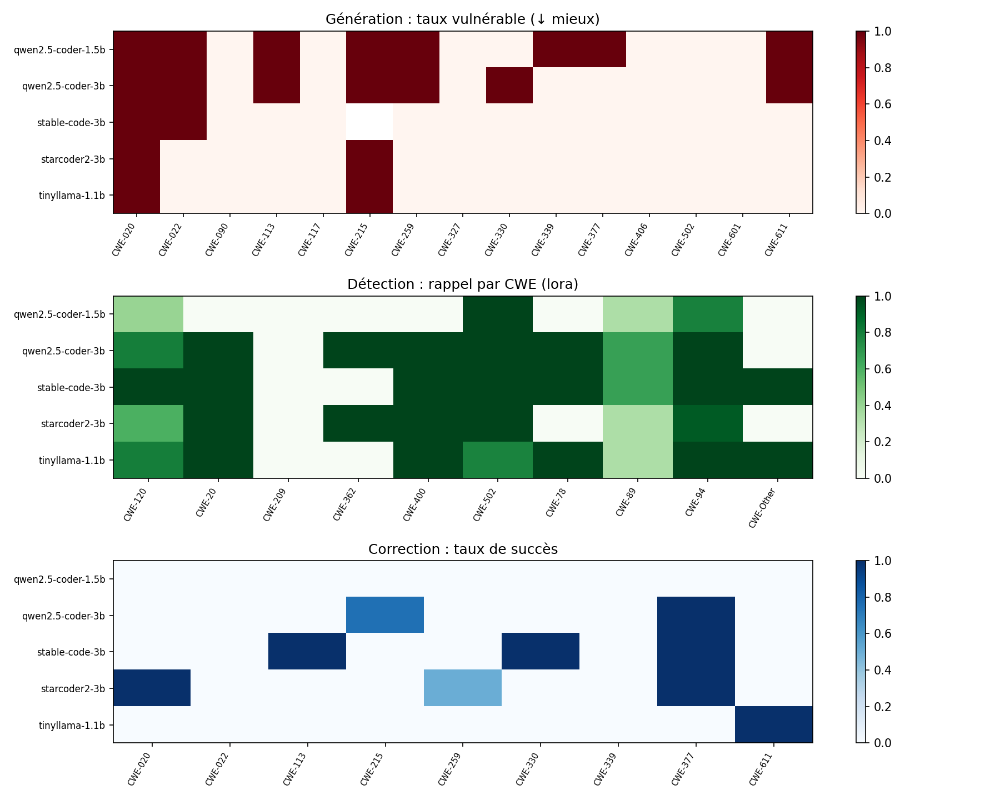
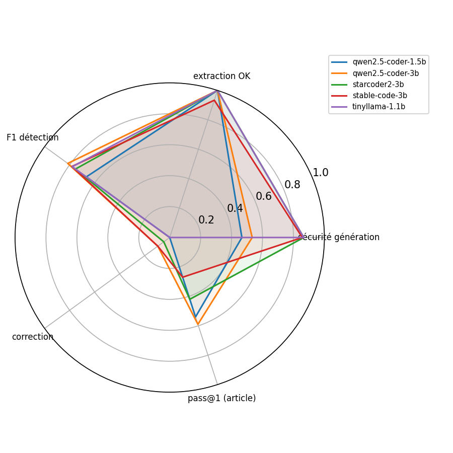

# Détection et analyse des vulnérabilités du code généré par des SLMs

_Cours « Système intelligent pour la sécurité » — INPT. Rapport final, novembre 2026._
_Les tableaux complets générés automatiquement sont dans `ANNEXE_RESULTATS_AUTO.md` ; toutes les données dans `results/`._

---

## Résumé

Nous évaluons cinq petits modèles de langage (SLMs, 1,1 à 3,1 milliards de paramètres) dans trois rôles :
**générateur** de code, **détecteur** de vulnérabilités et **correcteur**. Sur 15 prompts SecurityEval couvrant
15 CWE distincts :

- **29,7 %** des codes générés contiennent une vulnérabilité réelle détectée par Bandit (de 26,7 % à 40 % selon le
  modèle). Le plus « performant » fonctionnellement d'après l'article de référence (Qwen2.5-Coder-3B) est aussi le plus
  vulnérable (40 %).
- En détection, les SLMs **de base sont inutilisables** (F1 ≈ 0 : ils répondent presque toujours « sûr »). Un
  affinage **QLoRA de quelques minutes** sur 594 exemples les rend compétitifs : **F1 = 0,67 à 0,82** contre
  **0,64 pour Bandit**, avec une différence significative (McNemar, p < 0,05) pour 4 modèles sur 5.
- Le **RAG ajouté à l'inférence dégrade** 3 détecteurs sur 5 (il n'a pas été vu à l'entraînement).
- En correction, les vérifications automatiques acceptent 17 corrections sur 105, mais la **revue humaine n'en
  confirme que 5 (4,8 %)** : la validation automatique a une précision d'environ 29 %.

---

## 1. Contexte et objectifs

Les assistants de code basés sur des LLMs sont de plus en plus utilisés ; les SLMs, exécutables localement sur un GPU
grand public, sont attractifs pour la confidentialité et le coût. Hasan et al. (*JSS*, 2026) ont mesuré leur
performance fonctionnelle (pass@1) sur 20 SLMs ; nous complétons cette étude par l'angle **sécurité** :

1. Les SLMs génèrent-ils du code vulnérable, et lequel ?
2. Peut-on utiliser un SLM comme détecteur de vulnérabilités, et l'améliorer par affinage (LoRA) et RAG ?
3. Les SLMs savent-ils corriger les vulnérabilités détectées ?
4. Existe-t-il un lien entre taille, performance fonctionnelle et sécurité ?

Ce travail prolonge une première étude Bandit (5 prompts × 3 échantillons) dont nous avons corrigé sept défauts
(section 2.4).

## 2. Méthodologie

### 2.1 Modèles

| Modèle | Taille (B) | Format de prompt | pass@1 (article, Table 10) |
|---|---|---|---|
| Qwen2.5-Coder-1.5B-Instruct | 1,5 | chat | 0,54 |
| Qwen2.5-Coder-3B-Instruct | 3,1 | chat | 0,59 |
| StarCoder2-3B-Instruct (TechxGenus) | 3,0 | `### Instruction / ### Response` | 0,42 |
| Stable-Code-3B (modèle de base) | 2,8 | complétion | 0,27 |
| TinyLlama-1.1B-Chat-v1.0 | 1,1 | chat | absent de l'article |

Environnement : Google Colab, GPU T4 16 Go, fp16 (le T4 ne supporte pas bf16). Un seul modèle en mémoire à la fois.

### 2.2 Génération (P1)

- **15 prompts SecurityEval** (`s2e-lab/SecurityEval`), un par CWE distinct ; CWE-502, CWE-611 et CWE-020 forcés pour la
  continuité avec l'étude initiale, les autres tirés avec la graine 42. Mêmes prompts pour tous les modèles.
- Paramètres de l'article : temperature 0,2, top-p 0,95, 512 tokens max, 1 échantillon, graine fixe.
- Extraction robuste du code (blocs Markdown, heuristique, validation par `ast.parse`), jusqu'à 2 régénérations si
  l'extraction échoue ; Stable-Code-3B utilisé en mode complétion avec arrêt sur répétition.

### 2.3 Détection

**Approche A — Bandit (P2)** : un code est vulnérable s'il déclenche au moins une alerte **réelle** de sévérité
MEDIUM ou HIGH. Les alertes d'import B401–B413 (ex. `import pickle`) sont informatives et exclues.

**Approche B — SLM détecteur (P3)** :
- Jeu étiqueté : *CyberNative/Code_Vulnerability_Security_DPO* filtré sur Python (424 paires « vulnérable / sûr »),
  dédupliqué (52 doublons retirés), filtré contre toute fuite avec SecurityEval, découpé **par paire** en
  80/10/10 : **594 exemples d'entraînement, 74 de validation, 76 de test** (équilibrés 50/50).
- Sortie JSON stricte : `{"vulnerable": bool, "cwe": "CWE-xxx", "explanation": "≤ 30 mots"}`.
- QLoRA : 4-bit nf4, r = 16, α = 32, dropout 0,05, toutes les couches linéaires, lr 2e-4, 1 epoch, batch 2 × 8.
- RAG : base construite **uniquement** sur le train (exemples vulnérables + correctifs, règles Bandit → CWE, résumés
  CWE), embeddings bge-small-en-v1.5 + FAISS, 3 documents, ≤ 1 200 tokens.
- Quatre configurations comparées par modèle : `base` (zero-shot), `base_rag`, `lora`, `lora_rag`.

**Benchmark (P4)** : métriques sur le test étiqueté avec IC bootstrap 95 % et tests de McNemar ; puis rôles échangés
(chaque détecteur juge le code de chaque générateur) ; vérité terrain sur les codes générés = **pseudo-vérité par vote
majoritaire** (≥ 3 voix sur 6 : Bandit + 5 détecteurs LoRA), faute d'annotation humaine complète.

### 2.4 Corrections apportées à l'étude initiale

| Défaut de l'étude initiale | Correction |
|---|---|
| Une phrase sans code (Qwen-3B) comptée « saine » | Extraction validée par `ast.parse`, colonne `extraction_ok`, régénération |
| Stable-Code-3B boucle sur `### Instruction / ### Response` | Mode complétion, stop strings, coupe à la première répétition |
| Ligne 1 et extrait d'import pour toutes les alertes | Ligne et extrait issus du `line_number` de Bandit, dédupliqués |
| Alertes d'import B403/B405 comptées comme failles | Séparées : informatives, exclues des taux |
| Observations identiques pour tous les modèles | Générées à partir des données |
| 3 CWE seulement | 15 prompts / 15 CWE |
| Encodage cassé | Tout en UTF-8 |

### 2.5 Correction (P5)

Chaque code jugé vulnérable (21 codes) est corrigé par **chacun** des 5 SLMs (105 tentatives, 2 itérations max). Le
correcteur reçoit le code, la CWE, l'explication du meilleur détecteur et un exemple sûr récupéré par RAG.

- **Succès brut** : le code parse, Bandit ne signale plus d'alerte MEDIUM+, et le détecteur LoRA+RAG d'un **autre**
  modèle le juge sûr.
- **Succès strict** : succès brut et code réellement modifié (AST différent), fonctions conservées, pas de réécriture
  complète, aucun nom non défini, appels de la bibliothèque standard valides.
- **Revue humaine** des 17 succès stricts : la correction supprime-t-elle vraiment la vulnérabilité sans casser le code ?

## 3. Résultats

### 3.1 Génération : coût et qualité d'extraction

| Modèle | Extraction OK | Latence moy. (s) | Débit (tok/s) | Pic VRAM (Go) |
|---|---|---|---|---|
| Qwen2.5-Coder-1.5B | 100 % | **3,9** | 25,9 | 3,1 |
| Qwen2.5-Coder-3B | 100 % | 6,1 | 20,6 | 6,2 |
| StarCoder2-3B | 100 % | 9,8 | 25,1 | 6,1 |
| Stable-Code-3B | 93 % (1 échec) | 9,5 | 21,1 | 5,8 |
| TinyLlama-1.1B | 100 % | 8,9 | **34,6** | **2,2** |

Les corrections d'extraction fonctionnent : 74 codes sur 75 exploitables (contre une phrase prise pour du code dans
l'étude initiale). Les modèles 3B demandent environ 6 Go de VRAM, deux à trois fois plus que les modèles 1–1,5B.

### 3.2 Sécurité du code généré (Bandit)

| Modèle | Codes vulnérables (MEDIUM+) | Taux | Alertes réelles (H/M/L) | Règles dominantes |
|---|---|---|---|---|
| Qwen2.5-Coder-1.5B | 4 / 15 | 26,7 % | 2 / 3 / 2 | B301 pickle, B311 random, B202 tarfile |
| **Qwen2.5-Coder-3B** | **6 / 15** | **40,0 %** | 3 / 3 / 3 | **B201 Flask debug ×3**, B106 mot de passe |
| StarCoder2-3B | 4 / 15 | 26,7 % | 2 / 4 / 3 | B108 fichier temporaire ×3, B105 mot de passe |
| Stable-Code-3B | 4 / 14 | 28,6 % | 0 / 5 / 6 | B101 assert ×3, B311 random |
| TinyLlama-1.1B | 4 / 15 | 26,7 % | 2 / 3 / 4 | B311 random, B106 mot de passe, B108 |
| **Total** | **22 / 74** | **29,7 %** | | |

Les CWE qui piègent **tous** les modèles sont CWE-020 (désérialisation `pickle`/`yaml`), CWE-022 (chemins de
fichiers), CWE-259 (mots de passe codés en dur) et CWE-330 (aléa non cryptographique). Ce sont des failles de
« premier réflexe » : le modèle reproduit l'API la plus fréquente (`pickle.loads`, `random`, `debug=True`) sans tenir
compte du contexte de sécurité.

### 3.3 Détection sur le test étiqueté (76 exemples)

| Détecteur | base | base + RAG | **LoRA** | LoRA + RAG |
|---|---|---|---|---|
| Qwen2.5-Coder-1.5B | 0,00 | 0,00 | 0,67 | **0,77** |
| Qwen2.5-Coder-3B | 0,04 | 0,10 | **0,82** | 0,69 |
| StarCoder2-3B | 0,00 | 0,00 | **0,75** | 0,67 |
| Stable-Code-3B | 0,10 | 0,00 | **0,78** | 0,49 |
| TinyLlama-1.1B | 0,00 | 0,00 | **0,78** | 0,05 |
| *Bandit* | | | *0,64* | |

_Valeurs de F1. Meilleur détecteur : Qwen2.5-Coder-3B LoRA (F1 0,82 [IC 0,71–0,89], MCC 0,61, accuracy 80 %).
Bandit : F1 0,64 [0,51–0,74], MCC 0,19. Taux de JSON invalide : 0 % pour toutes les configurations._

Observations :
- **Zero-shot inutilisable** : les modèles de base répondent presque toujours `"vulnerable": false` (rappel ≈ 0).
- **La LoRA est l'élément décisif** : gain significatif pour les 5 modèles (McNemar base vs LoRA, p ≤ 0,02),
  pour seulement 3 à 6 minutes d'entraînement et 6 à 8 Go de VRAM.
- **LoRA > Bandit** de façon significative pour 4 modèles sur 5 (p < 0,04 ; seul Qwen-1.5B n'est pas significatif,
  p = 0,19). Bandit a un bon rappel (0,71) mais une faible précision (0,57) : il signale des appels sensibles sans
  comprendre le contexte.
- **Le RAG n'aide qu'un modèle** (Qwen-1.5B : 0,67 → 0,77, non significatif) et **dégrade fortement** Qwen-3B
  (p = 0,001), TinyLlama (p = 0,002) et Stable-Code. Explication probable : la LoRA a été entraînée sans contexte ; le
  contexte ajouté (exemples vulnérables) décale la distribution d'entrée, ce qui rend le modèle trop alarmiste
  (Qwen-3B : rappel 0,97 mais précision 0,54) ou muet (TinyLlama : rappel 0,03).
- **La taille compte peu** : TinyLlama 1,1B (F1 0,78) fait aussi bien que les modèles 3B une fois affiné.
- Quand ils détectent correctement, les détecteurs LoRA identifient la bonne CWE dans **76 à 100 %** des cas, contre
  41 % pour Bandit.

### 3.4 Rôles échangés : qui détecte quoi dans le code de qui ?

Taux de codes jugés vulnérables (configuration `lora`) :

| Générateur ↓ / Détecteur → | Qwen-1.5B | Qwen-3B | StarCoder2 | Stable-Code | TinyLlama | Bandit |
|---|---|---|---|---|---|---|
| Qwen-1.5B | 0,13 | 0,53 | 0,47 | 0,53 | 0,60 | 0,27 |
| Qwen-3B | 0,13 | 0,47 | 0,33 | 0,60 | 0,40 | 0,40 |
| StarCoder2-3B | 0,13 | 0,20 | 0,13 | 0,27 | 0,13 | 0,27 |
| Stable-Code-3B | 0,14 | 0,43 | 0,07 | 0,14 | 0,07 | 0,29 |
| TinyLlama-1.1B | 0,13 | 0,33 | 0,13 | 0,27 | 0,07 | 0,27 |

- **Accord modéré entre détecteurs** : kappa de Fleiss = 0,36, kappa de Cohen moyen = 0,35. Les détecteurs ne voient
  pas les mêmes failles.
- **Indulgence envers son propre code** : StarCoder2, Stable-Code et TinyLlama signalent nettement moins leur propre
  code que celui des autres (respectivement 13 % contre 25 %, 14 % contre 42 %, 7 % contre 31 %). Qwen-3B fait
  exception (47 % contre 37 %).
- Selon la pseudo-vérité, les deux Qwen produisent le code le plus vulnérable (53 % et 47 %), les trois autres
  environ 14 %. Ce classement diffère de celui de Bandit, qui ne distingue presque pas les modèles (27–40 %).

Comparés à la pseudo-vérité, Stable-Code LoRA (F1 0,88) et TinyLlama LoRA (0,80) sont les plus cohérents avec le
consensus, et Bandit le moins (0,56). **Attention** : cette vérité est construite à partir des détecteurs eux-mêmes
(chacun y a voté), elle n'est donc pas indépendante (section 4).

### 3.5 Taille, performance fonctionnelle et sécurité

| Lien testé | n | Spearman ρ | p |
|---|---|---|---|
| Taille ↔ taux vulnérable (Bandit) | 5 | 0,67 | 0,22 |
| Taille ↔ taux vulnérable (pseudo-vérité) | 5 | 0,15 | 0,81 |
| pass@1 ↔ taux vulnérable (pseudo-vérité) | 4 | 0,60 | 0,40 |
| Taille ↔ F1 de détection | 5 | 0,50 | 0,39 |

**Aucune corrélation significative** (avec 4 ou 5 modèles, il en faudrait une très forte). La tendance va toutefois
dans le même sens pour les deux mesures : **les modèles plus gros et plus performants fonctionnellement ne sont pas
plus sûrs**, voire le sont moins. Qwen2.5-Coder-3B, meilleur pass@1 de l'article (0,59), a le taux Bandit le plus élevé
(40 %). Un modèle qui « réussit » la tâche suit plus fidèlement la demande, y compris quand elle mène à une API
dangereuse. La performance fonctionnelle (pass@1) ne garantit donc pas la sécurité.

### 3.6 Correction automatique

| Correcteur | Succès brut | Succès strict | **Validé par la revue** | Taux réel |
|---|---|---|---|---|
| Qwen2.5-Coder-1.5B | 14 % | 0 / 21 | 0 | 0,0 % |
| Qwen2.5-Coder-3B | 43 % | 4 / 21 | 2 | **9,5 %** |
| StarCoder2-3B | 52 % | 7 / 21 | 1 | 4,8 % |
| Stable-Code-3B | 38 % | 4 / 21 | 2 | **9,5 %** |
| TinyLlama-1.1B | 19 % | 2 / 21 | 0 | 0,0 % |
| **Total** | 33 % | **17 / 105** | **5** | **4,8 %** |

- **Corrections réussies** (5) : `app.run(debug=True)` → `debug=False` (×2), `mktemp()` → `TemporaryFile` /
  `NamedTemporaryFile` (×2), `random.choices` → `secrets` (×1). Ce sont des remplacements **locaux d'une API par son
  équivalent sûr**.
- **Fausses corrections acceptées par les outils** (12) :
  - XXE « corrigée » par `XMLParser(remove_blank_text=True)`, qui ne bloque pas les entités externes ;
  - désérialisation `pickle` protégée par une liste noire `os`/`subprocess`, contournable (×5, dont deux qui
    plantent : TypeError) ;
  - `Content-Type` toujours contrôlé par l'utilisateur (injection d'en-tête, ×2) ;
  - mot de passe supprimé au lieu d'être lu depuis l'environnement (connexion cassée) ;
  - nom de fichier fixe et prévisible à la place de `mktemp` ;
  - changement cosmétique du type d'exception.
- **Correction croisée > auto-correction** : 17,9 % de succès stricts quand un modèle corrige le code d'un autre,
  contre 9,5 % sur son propre code. C'est cohérent avec l'indulgence envers son propre code observée en détection.
- 24 % des tentatives renvoient le code **inchangé** (67 % pour Qwen-1.5B).
- Garde-fous ajoutés au fil de l'analyse : une correction qui ne fait que supprimer une ligne vide, une autre qui
  utilise `io` sans l'importer et une troisième qui appelle `secrets.choice(..., k=16)` (TypeError) passaient les trois
  tests de base. Chacun de ces cas a conduit à un nouveau contrôle automatique.

### 3.7 Extras

**Localisation de la ligne vulnérable** (référence : lignes Bandit, tolérance ±1, 35 codes) :
Stable-Code 46 %, Qwen-1.5B 31 %, Qwen-3B 31 %, StarCoder2 0 %, TinyLlama 0 %. Les deux derniers ne renvoient pas un
numéro de ligne exploitable : l'échec vient du format de réponse plus que de la compréhension.

**Faux positifs et faux négatifs du détecteur LoRA** (test étiqueté, 5 modèles) :
- 52 faux positifs sur du code **sûr** contenant `subprocess`, `pickle` ou `open(` : les détecteurs réagissent à la
  présence d'une API sensible plutôt qu'à son usage, comme Bandit.
- Les faux négatifs se concentrent sur CWE-209 (fuite d'informations par message d'erreur, 10), CWE-89 (SQL, 8) et
  CWE-120 (7) : des failles qui dépendent du flux de données (`format()` dans une requête `execute()`), pas d'un appel
  isolé.

## 4. Limites

- **Petit échantillon** : 15 prompts × 5 modèles, 1 échantillon. Une différence d'un code vaut 6,7 points : les écarts
  de génération entre modèles ne sont pas statistiquement robustes.
- **Pseudo-vérité** : aucune annotation humaine des 74 codes générés ; la vérité est un vote majoritaire des
  détecteurs, donc biaisée en leur faveur. Les résultats des sections 3.4 et 3.5 basés sur cette vérité sont
  indicatifs. Le fichier `annotation_humaine.csv` est prêt pour une annotation par l'équipe.
- **Jeu d'entraînement réduit et synthétique** : seulement 372 paires Python CyberNative après filtrage (594 exemples
  d'entraînement, 76 de test). Les CWE sont déduites de descriptions textuelles par mots-clés, et le code « sûr » est
  supposé sûr. Les exemples courts et synthétiques diffèrent du code SecurityEval : les scores sur le test surestiment
  probablement la performance réelle.
- **RAG non vu à l'entraînement** : il explique la dégradation LoRA+RAG ; un entraînement avec contexte serait
  nécessaire pour juger le RAG équitablement.
- **Bandit** ne voit que des motifs d'appels (pas les failles logiques, pas le flux de données) ; il sert de référence
  mais pas de vérité.
- **Validation des corrections** : sans tests fonctionnels, ni les outils ni le validateur LoRA ne vérifient que la
  correction préserve le comportement ; seule la revue humaine (17 cas) le fait.
- **pass@1** provient d'un autre protocole (article) ; TinyLlama n'y figure pas ; corrélations sur n = 4 ou 5.
- **Matériel** : détecteurs en 4-bit, génération en fp16 ; latences mesurées sur un T4 Colab partagé.

## 5. Conclusion

1. **Les SLMs génèrent du code vulnérable dans près d'un cas sur trois**, surtout par réflexe d'API (pickle, random,
   debug, mots de passe en dur). Être meilleur fonctionnellement ne rend pas plus sûr.
2. **Un SLM brut n'est pas un détecteur** ; un **affinage QLoRA léger** (quelques minutes sur T4, < 600 exemples) le
   rend **meilleur que Bandit** (F1 0,82 contre 0,64). C'est le résultat le plus encourageant de l'étude : un détecteur
   local, peu coûteux et explicable (CWE + explication).
3. **Le RAG n'est pas un gain automatique** : sans entraînement adapté, il dégrade la détection.
4. **La correction automatique reste peu fiable** : 4,8 % de corrections réellement valides, et des vérifications
   automatiques qui acceptent 3 fausses corrections pour 1 vraie. **Une relecture humaine reste indispensable.**

**Perspectives** : annotation humaine des 74 codes ; entraînement LoRA avec contexte RAG ; jeu d'entraînement plus
réaliste (CVEfixes) ; tests fonctionnels pour valider les corrections ; échantillons multiples par prompt pour des
taux de génération statistiquement solides.

## 6. Reproductibilité

Notebooks `00` à `06` (Google Colab, T4), utilitaires `slmsec.py`, graine 42, checkpoints sur Google Drive. L'ordre
d'exécution et les choix d'implémentation sont décrits dans `README.md`.
